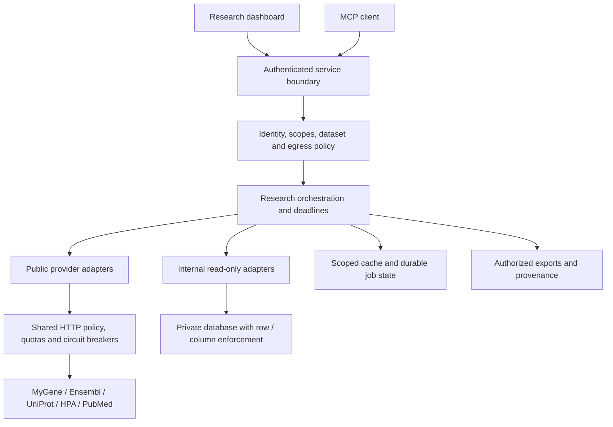

# BioMCP v0.3 review and next-version proposal

Review date: November 1, 2026. Status: design proposal for review, not an implemented production upgrade.

## 1. Recommendation and scope

Make v0.4 a reliable, scientifically explicit public-data service. Follow with a controlled internal-data pilot, then a production release after operational and security gates pass. Adding more databases before fixing request governance would multiply current failure modes.

This review covers the supplied Python source, dashboard, tests, packaging and documentation. The local command `.venv/bin/python -m pytest -q` passed all 9 tests. External documentation was checked for MCP authorization, NCBI quotas, Ensembl throttling and HPA access. Provider response contracts, deployed authentication, load behavior and live MCP interoperability were not tested. No application behavior was changed by this review. The supplied directory has no Git repository metadata.

Strengths to preserve: small reusable adapters, typed request models, independent provider fan-out, explicit partial results, source links, HTML escaping, opt-in genomic retrieval, and a localhost-only authenticated dashboard. There is no internal database integration in the reviewed code; the private-data design below is proposed.

## 2. Findings grounded in the implementation

P0 means required before remote or private-data deployment; P1 means required for a dependable public pilot; P2 means follow-on improvement. These are release priorities, not vulnerability scores.

| Priority | Finding and evidence | Consequence | Required revision |
|---|---|---|---|
| P0 | `clients.py:33–48` retries every `BioApiError`, including 400, 401, 403 and 404. | Repeats invalid, unauthorized or forbidden requests; wastes quota. | Separate terminal and transient errors; retry only explicitly allowed cases. |
| P0 | `research.py:69–70` caps `Retry-After` at 3 seconds and accepts only digit strings; legacy client ignores it. | Can request again before the provider permits, increasing block risk. | Honor full cooldown; parse HTTP dates and provider decimal seconds; defer beyond the call deadline. |
| P0 | `server.py:285` and `app.py:105` construct a new `ResearchService` for each invocation. | Cache and PubMed limiter reset across calls; concurrent callers have independent quota state. | Application-lifetime clients and bounded cache; quota coordinator shared across processes/replicas and entry points. |
| P0 | `research.py:325–365` has no total deadline; genomic request uses its own 30-second HTTP timeout. | Sequential normalization, retries and fan-out can exceed acceptable tool latency. HTTP timeouts are not end-to-end deadlines. | Propagate a monotonic deadline through queueing, requests, waits and aggregation; cancel unfinished work. |
| P0 | UI bcrypt login is separate from MCP; `server.py:270` exposes stdio/SSE choices without application authorization policy. | UI login cannot protect separately launched MCP tools or future private data. | Keep local trust explicit; add authenticated remote transport and per-call authorization before deployment. |
| P1 | `research.py:148` accepts unmatched terms based on prefixes `ENSG`, `P`, `Q`, `O`; lines 161/167 choose first cross-reference. | A plausible but incorrect gene/accession can become downstream evidence. | Validate full identifier syntax and exact cross-reference identity; return candidates when ambiguous. |
| P1 | Cache has TTL checks but no size bound or expired-entry eviction; partial results are cached as whole requests. | Long-lived reuse would grow memory and retain failed sources until aggregate expiry. | Byte/entry limits, expiry eviction, per-provider caching and explicit partial-result freshness. |
| P1 | `_genomic_sequence` bypasses the common retry path; legacy tools and research have separate network implementations. | Policy differs by tool and payload type. | One governed HTTP layer for JSON, FASTA and all adapters. |
| P1 | `_hpa` can return empty selected fields as a successful source. README_V2 describes a different endpoint. | Schema drift can look like successful retrieval. | Contract validation and distinct `no_data`/`schema_error` states; correct documentation. |
| P1 | `app.py:58` renders only successful source entries in its Source health tab; the overview uses a different renderer. | Failed providers disappear from the dedicated health table. | Render all requested providers and their explicit states from one component. |
| P1 | `research.py:82` logs upstream URL and response body; legacy exceptions include body snippets. | Future keys, private queries or sensitive upstream content could enter logs or tool output. | Structured sanitized errors; redact URL parameters, tokens and response content by default. |
| P1 | `dashboard.py:187` creates temporary export directories without application cleanup. | Disk usage grows; future private exports need scoped access and retention. | Managed export storage, quotas, authorization and cleanup schedule. |
| P1 | `_parse_fasta_sequence` skips subsequent headers and concatenates records; does not reject a missing first header. | Unexpected responses may be represented as one valid sequence. | Strict single-record parsing, alphabet/length checks and malformed-response tests. |
| P1 | Current tests cover basic contracts, mocked aggregation/cache, one partial failure and display helpers. | They do not establish retry safety, deadline enforcement, isolation or MCP compatibility. | Add the failure-injection and release tests below. |
| P2 | README references a Dockerfile and smoke-test script absent from this archive; dependency ranges are broad. | Release instructions and reproducibility are incomplete. | Tested install/run instructions, deployment artifacts, lockfile and dependency review. |

HPA correction: the implemented `/{EnsemblID}.json` route is documented by HPA; the route itself is not merely speculative. Its exact schema and the selected field names still need live contract validation. [HPA programmatic/download documentation](https://www.proteinatlas.org/about/download).

Biological wording also needs precision: the sequence of a selected UniProt entry is not proof that this entry is the canonical protein for a gene. Low-level Ensembl tools already accept cDNA/CDS types; the consolidated dashboard lacks transcript selection. Describe this distinction rather than claiming transcript retrieval is absent everywhere.

## 3. Next-version directions

| Direction | User value | Proposed deliverable | Dependency / exit criterion |
|---|---|---|---|
| Reliable retrieval — v0.4 core | Predictable latency and fewer upstream blocks | Shared request policy, quotas, deadlines, cache and partial-result envelope | Every adapter passes common failure tests |
| Scientific identity — v0.4 core | Correct gene, transcript, isoform and assembly | Exact identifier resolution; ambiguity candidates; explicit selection rules; versioned provenance | Curated cases have zero silent incorrect identity choices |
| Reproducible evidence — v0.4 core | Results can be inspected and reproduced | Source release/version when available, fetched time, checksums, normalized query and export manifest | Each returned assertion/sequence maps to its source record |
| Resumable batch research — v0.5 | Larger gene sets survive worker failures | Bounded jobs, provider checkpoints, pagination, cancellation and authorized artifacts | Crash/resume preserves completed work and attempt budgets |
| Public/private federation — v0.5 controlled pilot | Combine internal assays with public annotation | Dataset catalog, identity provider, policy checks, read-only internal adapters and egress controls | Tenant-isolation and revocation tests pass before private ingestion |
| Additional biology — after reliability gates | Richer pathway, variant or interaction context | Evaluate one adapter at a time; record licensing, schema, quota, evidence semantics and cost | Demonstrated research workflow and provider contract tests |
| Evidence synthesis — later experiment | Compare studies and contradictions | Citation-linked summaries with explicit missingness and evaluation dataset | Citation correctness and unsupported-claim evaluation; do not equate PubMed relevance with evidence quality |

Suggested order: v0.4 reliability and identity → v0.5 durable jobs and a private-data pilot → v1.0 operational release. Avoid adding autonomous write tools until there is a separate write authorization, idempotency and approval design.

## 4. Proposed service architecture

Keep provider credentials and quota state separate from request identity. Reuse connection pools through service startup/shutdown, but never keep a mutable current user on a shared client. Pass immutable caller context per request. Initially keep one deployable service; introduce a queue/worker only when batch work requires it. Use a shared quota store once multiple workers or separate UI/MCP processes share an upstream identity/IP. Never silently fall back to independent quotas if that store fails.

Suggested modules: `policy`, `http_policy`, `providers`, `orchestration`, `cache`, `jobs`, `provenance`, and transport-specific entry points. Existing tool names should remain compatible or receive an explicit migration path.

## 5. Retry, throttling, timeout and ban policy

### Proposed starting configuration

These are engineering defaults for review and load testing, not provider promises or measured service guarantees. A maximum of 3 attempts means 1 initial request plus at most 2 retries.

| Control | Starting proposal |
|---|---|
| Retry ownership | Only the shared provider HTTP layer retries; disable overlapping SDK/proxy retries. Persist budgets across resumed jobs. |
| Maximum attempts | 3 per logical idempotent upstream read, bounded by the remaining deadline and quota. |
| Backoff | Full jitter from 0 to `min(8s, 0.5s × 2^retry_index)`; effective delay is at least the provider cooldown. |
| HTTP phase limits | Connect 3s, pool acquisition 1s, read inactivity 7s, write 5s; additionally cap an attempt at 10s wall time. |
| Interactive deadline | 30s total from admission, including queueing, normalization, retries and aggregation; reserve 1s for finalization. |
| Normalization | At most 8s of the total budget; no fan-out after unresolved identity. |
| Large sequence retrieval | Separate operation with a proposed 60s total limit or a durable job; enforce byte and genomic-span caps. |
| Outbound request budget | Up to 3 attempts for each planned request. Current research uses up to 6 logical reads, or 7 with genomic sequence: theoretical maxima 18/21 attempts, usually cut short by deadlines. |
| Admission | Start with 2 active research calls per user; configure tenant/global ceilings and a bounded queue with a 2s maximum admission wait. Tune from load results. |
| Circuit breaker | Start with 5 consecutive transient failures per upstream quota scope; open for 60s, then permit one shared probe. Longer provider cooldown wins. |
| Repeated agent calls | Enforce server-side quotas and identical-request cooldowns; an LLM instruction to stop retrying is not enforcement. |

On cancellation, stop pending network calls and sleeps, release resources, and retain only already committed checkpoint data. A socket read timeout alone cannot stop a slowly streaming response; enforce wall-clock and byte limits while reading. Python 3.10 compatibility requires a supported deadline implementation, such as `asyncio.wait_for`, or an explicit supported-Python upgrade.

### Error decisions

| Outcome | Automatic action | Caller-visible result |
|---|---|---|
| 400 / 404 / 422 | No retry for unchanged inputs | `invalid_input` or `not_found`; corrective guidance |
| 401 | No general retry; a credential adapter may refresh once if safely supported, within the same budget | `authentication_required` if unresolved |
| 403 / explicit block or ban | Stop; suspend affected credential/provider route pending operator review | `forbidden` or `provider_blocked` |
| 429 | Share cooldown across the relevant provider/key/IP scope; honor full `Retry-After` | Retry only if it fits; otherwise `rate_limited` plus `retry_at` |
| 500 / 502 / 503 / 504, transient network timeout | Retry an idempotent read within limits; contribute to circuit breaker | `upstream_unavailable` after exhaustion |
| TLS certificate failure, malformed response or schema mismatch | No blind retry; surface/configure repair | `configuration_error` or `schema_error` |
| Deadline or caller cancellation | Cancel remaining work; no restart | Partial completed results or `deadline_exceeded` / `cancelled` |

Parse integer seconds and HTTP-date `Retry-After` values, plus documented decimal seconds such as Ensembl's `40.0`. Never shorten the delay to fit an interactive request: return partial/deferred work instead. Use a conservative configurable cooldown for malformed headers and alert on repeated occurrences. [Ensembl rate-limit documentation](https://github.com/Ensembl/ensembl-rest/wiki/Rate-Limits).

For a ban, capture a sanitized incident record, stop traffic, fix the cause and follow the provider's restoration process. Do not rotate IPs or credentials to evade the restriction. NCBI documents 3 requests/second without an API key and 10/second by default with a key; coordinate aggregate traffic by the applicable IP/key scope, including retries and both PubMed calls. Include registered tool/contact information and reserve headroom, for example 2.5 or 8 requests/second respectively. Other services sharing the same IP/key must participate in the budget. [NCBI usage and restoration guidance](https://eutilities.github.io/site/API_Key/usageandkey/).

Do not invent a universal quota for MyGene, HPA or UniProt. Record each provider's supported usage policy in configuration, start conservatively, monitor response headers and obtain higher-throughput access or use permitted bulk snapshots when needed.

## 6. Checkpoints and recovery

For short interactive requests, retain completed provider results and return them on deadline. Durable checkpoints become necessary for batch, expensive or long-running work; a TTL cache is not a checkpoint.

| Checkpoint | Persisted data | Resume rule |
|---|---|---|
| Accepted | Job ID, tenant/subject, authorized dataset references, request hash, options, schema/code version, expiry | Recheck current authorization; do not trust an old grant forever |
| Identity resolved | Exact IDs, taxonomy, assembly, transcript/isoform, resolver version and ambiguity decision | Reuse only under the same scientific context |
| Provider/page completed | Status, response/artifact reference, checksum, source release, fetch time, pagination cursor, attempt count, next permissible request time | Skip valid completed work; resume only pending/retryable stages |
| Result assembled | Provenance manifest and partial/complete status | Deterministic assembly with freshness/conflict labels |
| Export committed | Owner, ACL, object checksum and expiry | Recheck permission for every download; expired links do not grant permanent access |

Use states `queued → running → complete/partial/failed/cancelled`, with `waiting_for_provider` when scheduled outside interactive deadlines. Write each checkpoint atomically. Use leases and fencing/version checks so two workers cannot finalize the same stage. Assume at-least-once execution; a crash between upstream response and checkpoint commit can repeat a read. Make output writes idempotent and prevent a worker restart from resetting the attempt budget. A resumed background job may receive a new execution window, but retains its overall expiry and total retry budget.

Test recovery by killing a worker after normalization, after one provider result and during final export. Verify completed work survives, no cross-tenant read occurs, and cancellation prevents future scheduled retries.

## 7. Authentication and authorization across external/internal data

Authentication identifies the caller. Authorization decides which tool, dataset, records, fields and exports that caller may access. A third decision controls which data may leave the organization.

| Boundary | Authentication | Authorization and isolation |
|---|---|---|
| User → dashboard | Organization identity provider using OIDC; secure session handling | Map verified identity to tenant/projects and roles; apply tool/data policy server-side |
| MCP client → remote BioMCP | MCP-compatible OAuth authorization with discovery and validated access tokens | Check issuer, audience, expiry and scopes on calls; a session ID is not an identity |
| Local stdio host → BioMCP | Trusted OS process/host context | Limit installed tools and ambient credentials; do not treat UI login as inherited MCP authorization |
| BioMCP → public provider | No credential where public; otherwise provider-specific API key/workload credential | Provider quota/license policy; only approved public query fields may egress |
| BioMCP → delegated external account | Separate provider token acquired for that provider | Bind credential to caller/tenant, least scopes, expiry and revocation |
| BioMCP → internal database | Workload identity or short-lived DB credential; distinct read-only role | Verified project/tenant constraints plus DB row/column policies or restricted views |
| User → cached result/job/export | Same authenticated service boundary | Ownership/dataset authorization on every retrieval, including after revocation |

Use the pinned MCP authorization profile supported by target clients, and test discovery, challenge and refresh flows. Do not forward the MCP bearer token to databases or unrelated upstream APIs. Separate downstream credentials and validate token audience to prevent confused-deputy behavior. [MCP authorization](https://modelcontextprotocol.io/specification/2025-11-25/basic/authorization) and [MCP security guidance](https://modelcontextprotocol.io/docs/2025-11-25/tutorials/security/security_best_practices).

Suggested scopes are `research:public`, `dataset:read`, `sequence:export`, `job:submit` and `admin:providers`. Scopes alone are insufficient: also require project membership, dataset entitlement, allowed columns and permitted purpose where relevant. Obtain tenant identity from verified claims, never a model-supplied `tenant_id`. Use parameterized, bounded read operations rather than arbitrary model-generated SQL. Set and reset DB session context per transaction so connection pooling cannot carry one user's access into another request.

Federation example: a researcher authorized for Project A reads an internal assay table. BioMCP may query a public gene identifier externally only if Project A's egress policy permits it. It joins public annotation and private assay values internally, records both origins, and returns only permitted columns. It must not send patient IDs, sample labels, internal results, or an otherwise public gene list that reveals a confidential target program to an external provider. If even identifiers are sensitive, use an approved local public-data mirror or deny that external step. The host LLM is also a data destination: returning private tool output requires policy approval for that host/model environment.

Partition private caches by tenant, dataset/version and effective access context; reauthorize on retrieval. Public cache sharing is acceptable only for truly public payloads and non-sensitive lookup context. Keep private jobs, exports, audit records and embeddings under equivalent isolation. Store credentials in a secrets manager, rotate them, and redact them from logs/checkpoints. Deny private access if the identity/policy service is unavailable.

## 8. Production-readiness checklist and release evidence

All boxes below are open release gates; existing prototype functionality does not count as production validation. Assign a named person to each suggested owner before implementation.

| Gate | Checklist | Evidence required | Suggested owner |
|---|---|---|---|
| G1 Scope and data policy | [ ] Supported users, species, datasets, sensitive-data classes, allowed hosts and retention defined | Approved deployment/data-flow record; public-only boundary until private gates pass | Product + security |
| G2 Request governance | [ ] Unified retry, cooldown, quota, concurrency, circuit and byte limits across every adapter | Failure injection confirms exact attempt counts and no early post-429 requests across replicas | Backend |
| G3 Deadlines and cancellation | [ ] End-to-end deadline covers queueing, normalization and fan-out; completed results survive | Slow-stream, hung-provider, cancellation and exhausted-budget tests | Backend |
| G4 Scientific correctness | [ ] Exact identity, ambiguity, assembly, coordinates, strand, isoform and sequence type explicit | Curated positive/negative cases; malformed and multi-record FASTA rejection | Bioinformatics |
| G5 Contract and provenance | [ ] Versioned output schema; error taxonomy; source versions, timestamps, missingness and conflicts | Schema snapshots; source-to-output traceability; consumers pass compatibility tests | Backend + bioinformatics |
| G6 Identity and access | [ ] Remote authentication and tool/dataset/record/export authorization; secret rotation | Expired/wrong-audience token, revoked access, cross-tenant and pooled-connection tests | Security + backend |
| G7 Egress and agent safety | [ ] Provider allowlists, SSRF controls, sensitive-query policy, untrusted source-text handling | Block private/metadata addresses; prompt-injected source text cannot change permissions or destinations | Security |
| G8 Cache and persistence | [ ] Bounded cache, scoped keys, expiry, authorization checks, stampede suppression and checkpoint recovery | Cache isolation/eviction tests; worker-kill recovery; no duplicate artifact commits | Backend |
| G9 Storage lifecycle | [ ] Export ACLs, expiry, deletion, disk/object quotas, encryption and backups where needed | Expired-download denial; cleanup job; restore drill and retention audit | Platform + data owner |
| G10 Observability | [ ] Trace IDs, provider latency/errors, retries, quota waits, circuit state, cache hits and completeness | Dashboards and actionable alerts; logs verified free of secrets/private payloads | Platform |
| G11 Capacity and cost | [ ] Load model, tenant fairness, queue limits and cost/request measured | Agreed concurrency test with memory/FD stability; shared quotas hold under burst traffic | Platform + backend |
| G12 Deployment and supply chain | [ ] Reproducible dependencies, CI, image scanning, non-root runtime, startup config validation | Clean install/build, dependency report, staged deploy and rollback rehearsal | Platform |
| G13 MCP and UI compatibility | [ ] Handshake/tool schemas/cancellation/error mapping; remote transport support; visible partial states | End-to-end tests against intended clients, plus UI failed-source/download tests | Backend + QA |
| G14 Operations | [ ] Provider-block, outage, schema-drift, credential-leak and recovery runbooks; owners on call | Incident exercise; restore results; approved SLOs and escalation path | Platform + security |

Proposed initial objectives: 99.5% monthly service-controlled availability, p95 uncached interactive latency under 10 seconds when upstreams are healthy, and a 30-second hard application budget. Measure full-result completeness separately by source; a successful partial response must not hide a persistently unavailable provider. These targets require load validation. For durable pilot state, propose RPO ≤15 minutes and RTO ≤4 hours, subject to data-owner approval and restore drills; cached public data can be regenerated.

For tool output, use a consistent envelope with `schema_version`, `request_id`, `status`, normalized identity, source results, structured errors, timestamps and provenance. Source states should distinguish `ok`, `no_data`, `not_requested`, `forbidden`, `rate_limited`, `timeout` and `schema_error`. Include `retryable`, `retry_at` and attempt count where useful without exposing internal hosts or secrets. Large sequences should use authorized downloadable resources with size, checksum and expiry, rather than unbounded inline tool text. Preserve compatibility or version the changed contract.

## 9. Concrete acceptance scenarios

1. A 403 causes exactly one outbound request and disables further automatic attempts for the affected route until reviewed.
2. A 429 with `Retry-After: 120` returns a deferred/partial result within the interactive deadline; no replica contacts that quota scope before the cooldown ends.
3. `Retry-After: 40.0` and an HTTP-date are handled; invalid headers do not cause a rapid retry loop.
4. A timeout or retryable 503 generates no more than 3 attempts; deadline and cancellation can stop it sooner.
5. Ten concurrent UI/MCP calls share one PubMed quota, including retries and search/summary calls.
6. One hanging provider leaves successful providers visible with a timeout entry for the unfinished source.
7. An ambiguous alias or unmatched P/Q/O-prefixed input does not silently select the top-scoring gene.
8. A mismatched HPA schema produces an explicit schema/no-data state, not false completeness.
9. A user in Project B cannot retrieve Project A's cached response, job, export, resource URI or DB rows, even with guessed IDs.
10. Revoking a user's dataset access blocks resumed jobs and artifact reads; pooled DB sessions do not retain prior permissions.
11. Restarting a worker preserves completed stages, remaining attempts and provider cooldowns.
12. Very large/slow responses and repeated export generation stay within memory, time and storage bounds.

## 10. Suggested implementation packages

| Package | Changes | Completion criterion |
|---|---|---|
| A: Safe networking | Shared HTTP policy; terminal/transient classification; full cooldown parsing; redaction; regression tests | Scenarios 1–4 pass for both legacy and research tools |
| B: Shared runtime | Lifecycle-managed clients, bounded cache, quota coordinator, total deadlines, cancellation | Scenarios 5–6 and capacity tests pass through real entry points |
| C: Scientific contract | Exact normalization, transcript/isoform policy, strict FASTA, HPA contract, provenance, unified health UI | Scenarios 7–8 pass; no silent identity substitution |
| D: Deployment boundary | Authenticated remote transport, identity/policy layer, secrets, observability, reproducible packaging | Public pilot gates pass; existing stdio client remains compatible |
| E: Private pilot and jobs | Internal adapter, DB enforcement, egress policy, durable checkpoints and scoped artifacts | Scenarios 9–12 pass before enabling private datasets |

Decisions for the review meeting: choose the first deployment audience (local, team-hosted or multi-tenant); nominate the first private dataset and approved model host; agree scientific selection rules; set quotas/SLOs from expected traffic; assign owners to the gates. Packages A–C can proceed without waiting for a private-database choice.
