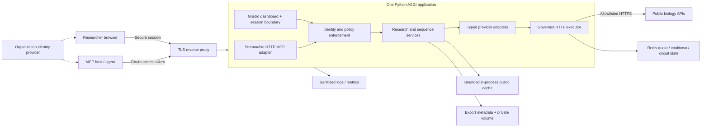
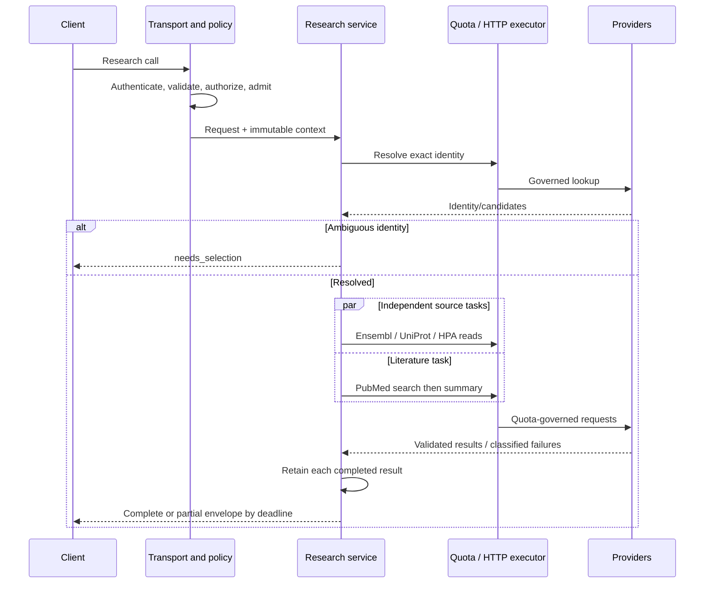

# BioMCP v0.4 MVP technical architecture

Date: November 1, 2026 · Status: proposed implementation baseline

This design translates the accepted [production review](../operations/production-readiness.md) into a buildable MVP. It defines the architecture; it does not claim that the components below are implemented. Defaults are initial engineering choices to validate in staging.

## 1. Product boundary and success criteria

**MVP:** an authenticated, team-hosted service that resolves a human gene unambiguously, retrieves public biological evidence, and returns bounded, source-attributed results through MCP and the existing research dashboard.

Deployment assumptions: one organization, one application replica initially, modest interactive traffic, public/non-confidential research queries only. Design capacity is 10 concurrent research operations, subject to provider quotas; this is not a throughput guarantee. The application contains no LLM runtime: the calling agent consumes deterministic tool results.

| Included in v0.4 | Deferred behind explicit boundaries |
|---|---|
| Existing six lookup tools plus compatible `research_gene` | New pathway/variant providers |
| Versioned research and explicit identity-resolution tools | Automated evidence grading or clinical interpretation |
| MyGene normalization; Ensembl, UniProt, PubMed evidence | Real private-database integration and private/PHI input |
| HPA adapter, enabled only after contract verification | Durable asynchronous batch execution |
| Safe HTTP policy, shared quota/cooldown state, bounded cache | Kubernetes, microservice decomposition and vector database |
| Remote MCP authentication; organization dashboard login | Internet-wide multi-tenant product |
| Bounded sequence retrieval and temporary authorized exports | Unbounded genome downloads or model-generated SQL |

A successful MVP must: never silently substitute a gene; never retry terminal responses; share upstream quotas across all entry points; honor complete cooldowns; finish interactive work within its deadline; preserve completed provider results on partial failure; and prevent unauthenticated tool/export access.

## 2. Deployment and trust boundaries



Use a modular monolith with ASGI lifespan-managed resources. Retain FastMCP, Pydantic, HTTPX and Gradio where compatible; select and lock an exact tested dependency set during implementation. Retain Python 3.10 compatibility initially, using `asyncio.wait_for`/`asyncio.wait` rather than requiring newer timeout APIs. The ASGI assembly may use FastAPI for dashboard mounting and small download/health endpoints; core services must not import it.

Deploy with an existing identity provider, a TLS reverse proxy, one application container, one Redis instance with persistence, and a bounded writable export volume. Redis and the application management endpoints are private-network only. No general-purpose application database is needed for interactive public research. A small SQLite export catalog on the volume is acceptable for this single-replica profile; it is not a durable job store.

Remote MCP uses Streamable HTTP at `/mcp`. Keep legacy SSE only as an explicitly tested compatibility mode, disabled by default. Implement origin/host validation and protocol negotiation. The selected reference profile supports stdio and Streamable HTTP; exact SDK/client interoperability is a release test, not something implied by the current broad dependency range. [MCP transport reference](https://modelcontextprotocol.io/specification/2025-11-25/basic/transports).

### Local execution profile

Preserve the existing stdio command and localhost dashboard for development. Both reuse the same core. If several processes share upstream egress, they must use the same Redis coordinator. An in-memory coordinator is permitted only in a clearly marked single-process development mode; it provides no cross-process quota guarantee. Hosted mode must refuse startup without shared coordination and valid authentication configuration. Stdio logs go to stderr.

## 3. Components and ownership

| Component | Responsibility | Must not own |
|---|---|---|
| Transport adapters | Parse tool/UI inputs, bind verified caller context, map domain results to transport | Provider calls or retry loops |
| Identity/policy service | Authenticate callers; authorize tool, export and egress actions | Scientific identifier selection |
| Resolver | Exact identifier resolution and candidate selection | Choosing a top-scoring ambiguous hit silently |
| Research service | Plan dependency graph, fan out, enforce deadline, assemble partial results | Transport-specific authentication |
| Provider adapter | Construct fixed endpoint requests; validate/normalize responses | Independent HTTP clients, quota state or retry policy |
| HTTP executor | Attempt budgets, timeout, redirects policy, streaming byte cap, retry/error classification | Biological interpretation |
| Quota coordinator | Atomic admission, shared cooldown and circuit/probe state | Caching scientific responses |
| Result cache | Bounded immutable provider results with freshness and schema keys | Authentication decisions or durable checkpoints |
| Export service | Atomic file creation, metadata, ownership, expiration and cleanup | Public static-file exposure |

Proposed layout under the existing package:

```text
src/ensembl_uniprot_mcp/
  bootstrap.py                 # dependency assembly and lifespan
  config.py                    # validated deployment/provider configuration
  domain/
    contracts.py               # versioned requests/results and errors
    identity.py                # resolved identity and selection policy
    context.py                 # caller, deadline, request/attempt budgets
  services/
    resolver.py
    research.py
    sequence.py
    exports.py
  providers/
    base.py
    mygene.py
    ensembl.py
    uniprot.py
    hpa.py
    pubmed.py
  infrastructure/
    http_executor.py
    quota.py                   # interface + Redis implementation
    cache.py
    export_store.py
    telemetry.py
  security/
    identity_provider.py
    policy.py
  transports/
    mcp.py
    web.py
    compatibility.py
  server.py                    # existing CLI retained
```

Core interfaces, expressed as design signatures:

```python
resolve(request, context) -> ResolutionResult
research(request, context) -> ResearchResult
fetch_sequence(request, context) -> SequenceResult
authorize(context, action, resource) -> PolicyDecision
execute(provider_request, context, attempt_budget) -> BoundedResponse
acquire(quota_scopes, deadline) -> PermitOrWait
record_cooldown(quota_scope, retry_at) -> None
```

`RequestContext` is immutable and contains request ID, authenticated subject/organization, verified scopes, egress classification, policy version and monotonic deadline. Never accept this context as tool arguments or put a mutable current user on a shared client. Authentication secrets are not fields on result models.

## 4. Tools and contracts

| Interface | Contract |
|---|---|
| `resolve_gene` — new | Accept explicit `identifier_type` (`symbol`, `ensembl_gene`, `uniprot_accession`, or `auto`); return resolved identity, ambiguity candidates or not found |
| `research_gene_v2` — new | Accept identity/query, selected providers, `max_papers` 1–10, optional small protein sequence; return schema `biomcp.research.v1` |
| `fetch_sequence_v2` — new | Accept explicit stable ID/accession, sequence type, assembly and optional strand; return inline bounded data or an owned artifact |
| Existing seven tools | Preserve input signatures and successful output shapes using compatibility adapters over the same governed services |
| `GET /downloads/{artifact_id}` | Authenticate, authorize owner, check expiry, stream from server-controlled path |
| `/health/live`, `/health/ready` | Process liveness versus local dependency/configuration readiness; no live provider probes on every check |

Do not insert a new envelope into legacy output shapes without versioning. For legacy calls exceeding inline size limits, return an explicit size-limit tool error with guidance to `fetch_sequence_v2`; do not truncate silently. Map domain failures to MCP tool execution errors, leaving protocol errors for malformed protocol requests. Dashboard callbacks invoke the same v2 services, not HTTP providers directly.

Proposed v2 research request:

```json
{
  "query": "TP53",
  "identifier_type": "symbol",
  "species_taxon_id": 9606,
  "providers": ["ensembl", "uniprot", "pubmed"],
  "max_papers": 5,
  "include_protein_sequence": false
}
```

The consolidated tool is human-only for this MVP. Legacy species-aware tools retain their documented species behavior. Unsupported species/assemblies fail validation. Genomic DNA is a separate bounded operation; no implicit large fetch is part of research fan-out.

| Result field | Meaning/invariant |
|---|---|
| `schema_version`, `request_id` | Stable machine contract and correlation identifier |
| `status` | `complete`, `partial`, `failed` or `needs_selection` |
| `identity` | Input; resolved gene IDs/taxon; optional transcript/accession; selection policy and ambiguity decision |
| `sources` | Exactly one entry per requested provider; optional providers omitted by request do not count as failures |
| `sources[name].status` | `ok`, `no_data`, `timeout`, `rate_limited`, `forbidden`, `unavailable`, `schema_error`, `disabled` |
| `sources[name].data` | Typed provider-specific payload; absent on errors |
| `sources[name].error` | Stable code, sanitized message, retryability and optional UTC `retry_at` |
| `sources[name].provenance` | Provider, record IDs/URL, original fetched time, release if available, payload checksum, adapter version |
| `sources[name].cache` | Hit flag, age and freshness; never rewrite fetched time on a hit |
| `warnings`, `completed_at` | Missingness/conflicts and final assembly time |

`complete` means all requested sources completed with `ok` or valid `no_data`; it does not assert scientific completeness. `partial` requires at least one completed source and at least one failure. `failed` means resolution failed or every requested source failed. `needs_selection` returns candidates before downstream fan-out. Zero requested providers is invalid. A source returning valid empty results is distinct from a schema change producing unknown fields.

## 5. Scientific identity and provider contracts

1. Classify identifiers using full syntax, not first-letter prefixes. Validate species and assembly before requesting data.
2. For a symbol, require an exact approved symbol or uniquely matching alias. For an accession/Ensembl ID, require exact agreement with a returned cross-reference or verify against the authoritative provider.
3. Multiple plausible genes or mappings produce candidates with stable IDs and selection reasons. A subsequent explicit selection is revalidated; client-provided candidate metadata is not trusted.
4. Preserve multiple transcript/protein mappings. Only select automatically under a named, tested rule; otherwise require an explicit accession/transcript for sequence retrieval.
5. Record genomic coordinates as 1-based inclusive, assembly and strand. A UniProt entry's canonical sequence is described as canonical for that entry, not automatically for the gene.

MyGene remains the initial resolver, but schema adapters must validate response types and exact matches. Resolver verification may add requests; every additional read is declared in the execution plan and counts toward the same per-request budget. Set a ceiling of 24 outbound attempts per interactive research operation, including resolution verification; each logical read still has a maximum of 3 attempts.

HPA starts disabled until a representative fixture corpus and a live smoke check establish its selected fields and empty-data behavior. Its `/{EnsemblID}.json` route is officially documented. [HPA access documentation](https://www.proteinatlas.org/about/download). PubMed ordering remains retrieval relevance, with no evidence-grade label.

For sequence parsing, reject missing headers, unexpected multi-record FASTA, invalid alphabets and inconsistent reported length. Preserve entry version and sequence checksum. Do not merge or silently trim separate sequences.

## 6. Request lifecycle and deadline behavior



Create a 30-second deadline at application ingress; admission wait consumes it. Reject oversized bodies early at the proxy. Admit at most 10 active operations globally and 2 per subject; bound the waiting queue to 20, with a 2-second maximum wait. Sequence operations consume the same admission slots. These are initial load-test settings.

Normalization receives at most 8 seconds and leaves the remaining budget for source work. Stop provider work at total deadline minus 1 second; cancel and await unfinished tasks, then assemble already completed results. Maintain a result map populated as each task finishes rather than a single all-or-nothing `gather`. PubMed search and summary share the parent deadline.

Propagate caller cancellation immediately; do not continue unrequested work after disconnect. If the transport is already disconnected, there is no guarantee the caller receives a partial response. The MVP does not promise resume-after-crash: completed values live in memory/cache and an interrupted call must be submitted again.

## 7. Shared outbound policy

HTTPX phase timeouts are not a total request deadline; wrap each attempt and the entire operation in wall-clock cancellation. [HTTPX timeout semantics](https://www.python-httpx.org/advanced/timeouts/).

| Setting | MVP default |
|---|---|
| Attempts | At most 3 per logical idempotent GET; no other retry layer |
| HTTP limits | Connect 3s, pool 1s, write 5s, read inactivity 7s; attempt wall limit 10s or remaining budget |
| Backoff | Full jitter, base 0.5s, cap 8s; full provider cooldown takes precedence |
| Retryable outcomes | Transient network timeouts and HTTP 500/502/503/504; 429 only after shared cooldown |
| Terminal outcomes | 400/401/403/404/422, certificate errors, schema/parse failures; no unchanged-input retries |
| Invalid/missing 429 cooldown | Conservative 60s shared pause with alert; no immediate blind retries |
| Breaker | 5 consecutive transient failures → 60s open; one shared half-open probe |
| JSON body | 2 MiB decoded cap per upstream response; cap while streaming |
| Sequence | 10 MiB decoded upstream cap; 1 million-base region ceiling; 60s total operation deadline |
| Tool output | 256 KiB serialized cap; larger v2 sequence result becomes an artifact |
| Pool | Initially 20 total outbound connections and bounded per-provider concurrency |

A regular 403 is terminal for that request; repeated permission failures can suspend the affected credential/route. An explicit provider ban suspends its full applicable scope pending operator review. This refines the review's conservative 403 rule: one record-level denial must not accidentally disable an entire public provider for everyone.

Use allowlisted configured HTTPS base URLs, fixed adapter paths, TLS verification and no automatic redirects. Do not accept arbitrary remote URLs as tool input. Proxy use must be explicit and trusted; private/metadata-network destinations are blocked for public providers.

### Quota coordinator algorithm

Maintain quota scopes by provider plus credential identity and/or shared egress identity, according to the provider's policy. Never use raw credentials in Redis keys. Every attempt, including retries, must acquire a permit immediately before transmission.

Use a short atomic Redis script to check cooldown, circuit state and all applicable pacing scopes, and reserve one permit only if every scope allows it. Use Redis time for shared scheduling, return a wait duration, and let callers sleep outside Redis before retrying acquisition. Do not sleep inside a script or pre-reserve a long chain of future slots. Atomic script execution is supported by Redis; keep script runtime bounded. [Redis scripting reference](https://redis.io/docs/latest/develop/programmability/eval-intro/).

Start NCBI pacing at 2.5 requests/second without a key, or 8 with a standard key; burst capacity 1. Both search and summary count. Published defaults are 3 without a key and 10 with one; shared users of the same key/IP must be included in coordination. [NCBI usage policy](https://eutilities.github.io/site/API_Key/usageandkey/). Configure other providers conservatively, initially 1 request/second per provider scope until documented policy and smoke tests justify changes; these are application limits, not claims about provider quotas.

On 429, atomically extend cooldown using `max(existing, new_retry_at)`. Parse HTTP dates, integer seconds and provider decimal seconds. Do not clamp a valid cooldown to the remaining deadline. If it cannot fit, return `rate_limited`; the MVP does not schedule a background retry. [Ensembl cooldown semantics](https://github.com/Ensembl/ensembl-rest/wiki/Rate-Limits).

On coordinator failure, do not issue new upstream calls. Authorized fresh cache hits may still be served as degraded operation. Configure control Redis with persistence and no eviction; do not share its memory budget with evictable payload caching. Loss of control state requires an operator recovery gate before outbound traffic resumes, since an arbitrary long cooldown cannot safely be reconstructed from an empty store. Retries by the client cannot reset server cooldowns.

## 8. Cache, exports and checkpoint boundary

Use a process-wide provider cache: 128 MiB total, at most 1,000 entries, explicit byte accounting and LRU/TTL eviction. Default TTL 5 minutes; no stale fallback in the MVP. Cache validated `ok` results; valid `no_data` may use a 30-second TTL. Do not cache permission errors or transient failures as scientific data.

Key material: provider, adapter/schema version, normalized identifiers, taxonomy, assembly, transcript/isoform, query parameters and requested fields. Canonicalize and hash key material. Only approved public/non-confidential inputs are eligible for cross-user sharing. Return copies/immutable models to prevent callers mutating cached values. Single-flight de-duplication uses the same key; cancelled followers detach, and the leader stops when no callers remain, subject to its own bounded deadline.

For sequence artifacts, create a random artifact ID, write to a temporary file, compute SHA-256, atomically rename, then commit catalog metadata. Metadata contains owner subject/organization, relative server-generated path, content type, length, checksum, created/expiry time and classification. The path is never accepted from a caller. Default retention 1 hour; volume quota 1 GiB, with per-owner limits. Sweep every 5 minutes and at startup; remove orphan temporary files. An expired artifact is denied even before deletion occurs.

Serve downloads only through authorization, never Gradio's unrestricted filesystem exposure or a public static mount. Remote clients unable to open authenticated download URLs need an authorized MCP resource/read mechanism, tested with target clients; do not claim universal artifact support. Small inline sequences remain interoperable. A file and its catalog row are committed before publishing its ID; crashes can leave orphans but never a deliberately published half-written file.

**Checkpoints:** v0.4 has in-request stage completion and reusable public cache entries, but no durable job API. A future `JobStore` will persist normalized identity, completed provider stages, total attempts, cooldown reference, policy context and output checksums. Durable jobs require PostgreSQL, worker leases/fencing, idempotent commits and authorization rechecks on resume. Those components are a v0.5 gate, not hidden requirements for this MVP.

## 9. Authentication, policy and future internal databases

Hosted authentication is mandatory. MCP uses access tokens intended for BioMCP, validated for issuer, audience, lifetime and required scopes, with authorization discovery compatible with the chosen client profile. The dashboard uses an organization OIDC login and server-controlled secure session. Do not accept browser-provided identity headers. If a trusted proxy supplies identity, strip inbound copies and restrict direct application access.

Both transports produce the same `Principal` and enforce policy again at tool invocation and artifact retrieval. Initial scopes: `research:public` and `sequence:export`; provider administration is a restricted operational action, not an agent tool. Session cookies require secure/HttpOnly settings and appropriate SameSite/CSRF protection. MCP protocol session identifiers are not authentication credentials. [MCP authorization reference](https://modelcontextprotocol.io/specification/2025-11-25/basic/authorization).

Provider keys are distinct workload secrets. Do not forward a BioMCP access token to an upstream biology service. For public-only stdio, identity is the trusted local OS host profile; do not imply hosted OAuth is inherited from a dashboard login.

The extension boundary for private data is a separate `InternalDataProvider` plus dataset policy, not a configurable public-provider URL. Before activation, require:

| Extension | Required implementation |
|---|---|
| Dataset catalog | Dataset IDs, owners, classification, project grants, allowed columns and egress rules |
| Database connection | Dedicated read-only workload role, parameterized bounded operations, transaction-scoped tenant context |
| Enforcement | Tool scope plus row/column/project authorization; DB policies or restricted views as defense in depth |
| Federation | Public annotation joins happen internally; only policy-approved identifiers may leave the organization |
| Private cache/export | Tenant/dataset/version/access-context isolation, authorization on every read and revocation behavior |
| Model-host policy | Explicitly approved host/model destination before returning private tool content |

A public gene identifier may still reveal a confidential research program. Public-provider access is denied for confidential requests unless a data owner has approved that egress. Private data support requires its own threat model and negative access tests; it cannot be enabled merely by supplying DB credentials.

## 10. Observability and operating model

Emit structured logs with request ID, operation, provider, status/error code, latency, attempt count and policy outcome. Exclude tokens, raw queries, upstream bodies and full request URLs. Keep user IDs out of metric labels. Record pseudonymous subjects only where needed in protected audit events.

Metrics: admission wait/rejection, operation latency, provider success/no-data/failure rates, response bytes, attempt count, quota wait, cooldown remaining, breaker state, cache occupancy/hits, export disk usage and cleanup failures. Measure full source completeness separately from service availability.

Liveness checks the process; readiness checks configuration, required auth material, quota coordinator and export writeability. A single upstream outage produces degraded results rather than a liveness failure/restart storm. Graceful shutdown stops admission, allows bounded in-flight completion, cancels remaining tasks and closes clients.

Runbooks cover provider block, coordinator loss, identity-provider/JWKS failures, schema drift, disk exhaustion and rollback. Retain already-valid cached verification keys only under the chosen identity library's bounded policy; never accept unverifiable tokens during an outage. Disable a failing optional provider through configuration with an explicit result state.

## 11. Implementation sequence and release gates

| Milestone | Concrete implementation | Required proof |
|---|---|---|
| M1 Contracts and composition | Domain models, immutable context, validated config, application lifecycle, legacy adapters | Existing tests pass; legacy schema snapshots; no per-call service construction |
| M2 Governed I/O | HTTP executor, shared quota store, deadlines, cancellation, byte limits | Exact attempt tests; 120s/decimal/date cooldown tests; concurrent UI/MCP quota test; slow-stream cancellation |
| M3 Scientific services | Resolver, typed adapters, source envelopes, bounded cache and unified dashboard status | Ambiguous-ID cases; malformed FASTA; HPA fixture/live check; partial deadline retains completed results |
| M4 Hosted boundary | Streamable HTTP, IdP integration, dashboard session, owned exports, deployment package | Real target-client handshake; wrong-audience/expired token rejection; unauthorized/expired export denial |
| M5 Pilot validation | Telemetry, load script, runbooks, dependency lock, CI and rollback | 10 concurrent calls; stable resources; provider quotas never exceeded; blocked-provider and Redis-loss exercises |

Do not claim M4 complete using mocked authentication alone. Test with the chosen organization's identity provider and at least one actual target MCP client. No private dataset is loaded as part of MVP validation.

Testing layers: deterministic unit tests with fake clock/randomness; HTTP mock contract tests; Redis integration tests with separate processes; application lifespan and transport tests; opt-in low-rate live provider smoke tests; end-to-end auth/export checks; bounded staging load. Live tests never run high-volume against public providers.

Release acceptance: all current tests plus new failure/security tests pass; no early retry after a valid cooldown; no unauthorized tool/export access; no silent ambiguous identity choice; every requested source has a terminal status; no more than 30 seconds of interactive application work under the tested load; no unbounded memory/disk growth. Include small scheduling tolerance in test assertions and use a separate proxy timeout above the application budget. Proposed p95 <10 seconds for healthy upstreams is measured as a performance target, not a guaranteed gate independent of provider latency.

## 12. Architecture decisions and remaining deployment inputs

| Decision | Rationale | Revisit trigger |
|---|---|---|
| Modular monolith | Shared lifecycle/policy with minimal operations overhead | Independent scaling or ownership becomes necessary |
| Redis for control state; local bounded cache | Separate quota safety from expendable response caching | Multiple replicas need cache sharing; control safety remains separate |
| Versioned new tools + legacy adapters | Improve semantics without silently breaking consumers | Explicit major-version migration |
| One hosted replica + local export catalog | Sufficient for a team pilot | Availability/scale requires replicated app and shared object/catalog storage |
| Public data only | Can validate retrieval before taking on private-data handling | Dataset owner, egress policy and isolation tests approved |
| No durable jobs in v0.4 | Interactive use does not justify workers/DB state yet | Batch volume or execution duration exceeds interactive limits |

Deployment inputs still to supply: identity-provider issuer/client registrations, approved MCP hosts, TLS domain, hosting environment/egress identity, provider contact/key configuration, and operator ownership. These do not block M1–M3. They do block claiming hosted authentication and deployment validated. The next engineering step is M1 followed by M2, keeping the current entry points working throughout the migration.
