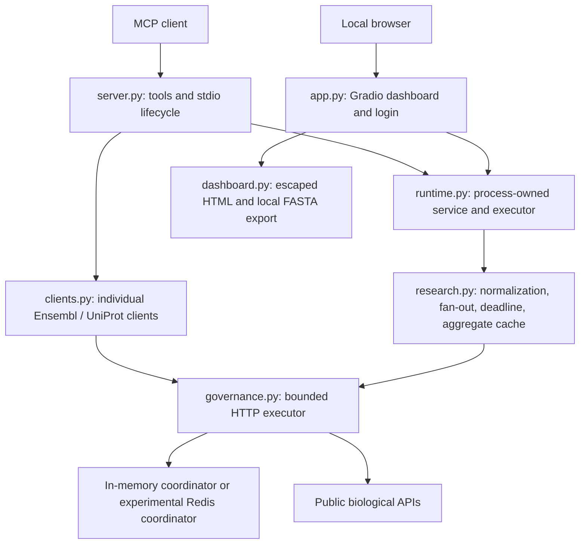

# Current architecture

Status: implemented local v0.4 MVP. For the target hosted architecture, see the [design proposal](mvp-design.md); for open work, see [implementation status](../operations/implementation-status.md).

## Runtime boundaries

The dashboard and stdio server are separate processes when launched separately. Their in-memory caches and quotas are not shared. Redis coordination is optional and experimental. Dashboard login applies only to its browser interface; the local MCP host controls stdio access.

## Module responsibilities

| Module | Responsibility |
|---|---|
| `server.py` | Tool declarations, compatibility interfaces, v2 result mapping and MCP shutdown lifecycle |
| `runtime.py` | Shared service/executor construction and hosted-profile guard |
| `research.py` | Human identity resolution, provider mapping, parallel retrieval, deadline, partial results and aggregate cache |
| `clients.py` | Individual Ensembl/UniProt API operations; executor shared, HTTP clients still per call |
| `governance.py` | Retry classification, cooldown parsing, pacing, failure pause, attempt and decoded-body limits |
| `models.py` | Typed legacy result records |
| `dashboard.py` | Rendering, source status and prototype local FASTA file generation |
| root `app.py` | Local dashboard assembly, credential check and callbacks |

The package remains flat because its implemented component count is small. Organize future modules into service/provider/infrastructure subpackages when those boundaries are implemented, following the design proposal. Do not add empty layers that imply completed functionality.

## Request flow

1. MCP or dashboard validates input and gets the process-owned research service.
2. Research acquires a bounded admission slot and resolves the human gene identity.
3. Independent providers run concurrently; PubMed search and summary remain sequential.
4. Each HTTP read passes through the common executor and coordinator.
5. Completed source results are retained. Pending tasks are cancelled and awaited at the research deadline.
6. Complete successful aggregates enter the bounded TTL cache. Partial responses expose provider errors and are not cached.

Individual sequence/lookup tools use the same executor, but not the research admission/cache path. The v2 research envelope is implemented; versioned sequence exports and durable job checkpoints are proposed work.

## Verification boundaries

| Area | Evidence |
|---|---|
| Components | Retry/error/cooldown/size/FASTA/identity tests |
| Provider integration | Mocked research aggregation, caching and partial/deadline tests |
| MCP end to end | Real subprocess handshake, tool discovery and mocked-provider research calls |
| Live providers | Opt-in [validation tutorial](../guides/validation.md), not routine CI |
| Hosted/private data | Unimplemented; not supported by local test results |

## Deployment artifacts

Root `Dockerfile` builds the stdio MCP package. It is not a hosted dashboard or authenticated remote service deployment. `.github/workflows/ci.yml` runs local checks across declared Python versions; a configured matrix is not evidence that remote jobs have already passed. Operational release gates are maintained in the [production review](../operations/production-readiness.md).
